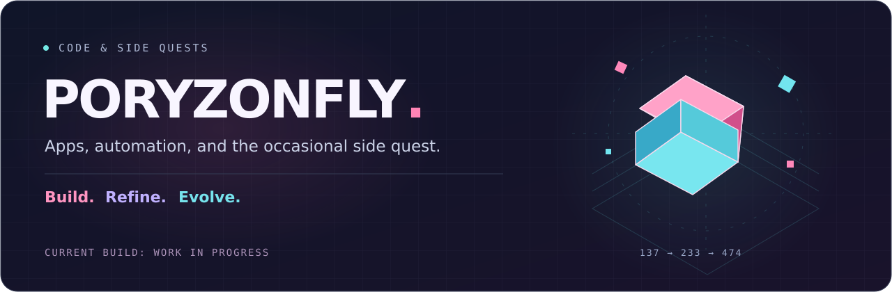
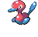
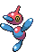

  

  <a href="#about">About</a> &nbsp; / &nbsp;
  <a href="#projects">Projects</a> &nbsp; / &nbsp;
  <a href="#stack">Stack</a>

  <table>
    <tr>
      <td align="center" width="230">
         
          
          
        <code>PORYGON · #0137</code>  
      </td>
      <td align="center" width="230">
         
          
          
        <code>PORYGON2 · #0233</code>  
      </td>
      <td align="center" width="230">
         
          
          
        <code>PORYGON-Z · #0474</code>  
      </td>
    </tr>
  </table>

## About

I build apps, automate the repetitive stuff, and spend a slightly unreasonable amount of time on Minecraft tools.

I like clean interfaces, useful features, and small details that make software feel good to use. Mostly working with TypeScript and Python, with a few other languages in the mix.

Outside the code: games with far too many moving parts.

## Projects

| Project | What I'm building | Stage |
| :--- | :--- | :--- |
| **Budgon** | An offline-first budget tracker for spending, accounts, budgets, and savings goals. React, TypeScript, and Capacitor. | In development |
| **Joseph** | Minecraft server management through Discord: status, backups, and world maps. | In development |
| **Iso-Map** | Isometric Minecraft renders in Discord, with rotating map GIFs for the full view. | Beta |
| **HR App** | A workflow app to make everyday HR admin easier to organize and less repetitive. | Planned |
| **Secret Game** | A game idea still on the drawing board. Keeping this one under wraps for now. | In planning |

Current source code is private. The last two are still in planning.

## Stack

**Interfaces & apps** &nbsp; `React` `TypeScript` `Kotlin` `HTML / CSS` `Capacitor`

**Logic & data** &nbsp; `Python` `Flask` `Java` `C / C++` `SQL`

**Tools & infrastructure** &nbsp; `Git` `Linux` `Docker` `Oracle Cloud`

  
▸ Dubious Disc

   
  

    
    
<code>Upgrade complete. Results may vary.</code>

    No Porygons were debugged in the making of this profile.
  

Pokémon sprites via <a href="https://github.com/PokeAPI/sprites">PokeAPI</a>. Pokémon belongs to Nintendo, Game Freak, and Creatures. Fan-made profile.

